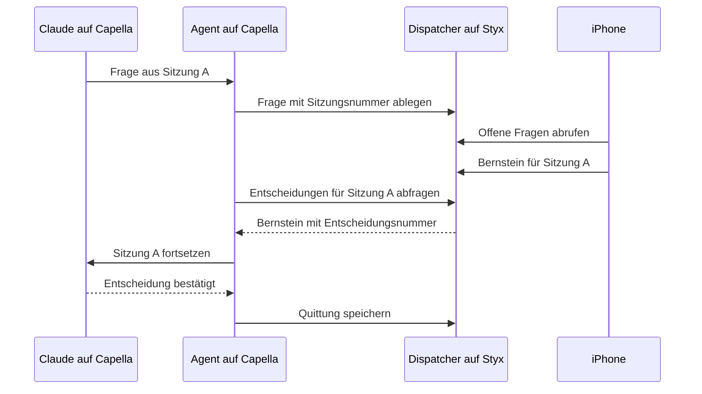

# Claude Remote für Einsteiger

Stell dir vor, Claude arbeitet auf einem anderen Rechner an zwei Projekten. Für Projekt **A** braucht es deine Entscheidung zur Farbe. Projekt **B** braucht deine Freigabe für einen Entwurf. Du bist unterwegs und siehst das Terminal nicht. Claude Remote soll dir beide Fragen aufs iPhone bringen und jede Antwort an das richtige Projekt zurückgeben.

## Wer macht was?

| Teil | Bild im Kopf | Was hier wirklich läuft |
| --- | --- | --- |
| Claude Code | Der Kollege, der an einem Projekt arbeitet | Eine Claude-Sitzung auf dem Entwicklungs-Uberspace **Capella** |
| Agent | Der Bote mit einer Liste der Auftragsnummern | Ein Python-Prozess auf Capella, der den Dispatcher regelmäßig abfragt |
| Dispatcher | Das Büro, das offene Fragen und Antworten zusammenhält | FastAPI und eine SQLite-Datei auf dem vorgesehenen Dispatcher-Uberspace **Styx** |
| SwiftUI-App | Dein Posteingang und Antwortformular | Die iPhone-App zeigt Fragen und übermittelt deine Antworten |
| APNs | Apples Klingel für Mitteilungen | Apple kann einen kurzen Hinweis ans iPhone schicken. Die App holt die eigentliche Frage beim Dispatcher |

## Eine Frage einmal ganz durchgespielt

1. **Claude fragt.** Im aktuellen Demo gibst du beim Start eine Frage vor, etwa „Welche Farbe soll das Muster bekommen?“. Claude gibt sie zurück. Der Agent schickt sie mit der Sitzungsnummer an den Dispatcher.
2. **Der Dispatcher legt die Frage ab.** Ab jetzt kann dein iPhone nachsehen, auch wenn du die App erst später öffnest. Mehrere Fragen für dieselbe Entscheidung können gemeinsam als **Fragebatch** erscheinen.
3. **Du entscheidest.** Du tippst „Bernstein“ oder wählst bei einer Freigabe „Freigeben“ oder „Ablehnen“. Die App sendet die Entscheidung. Der Dispatcher speichert sie für die Sitzung, die den Batch erstellt hat.
4. **Der Agent holt die Antwort ab.** Der Agent für A bekommt „Bernstein“. Eine Abfrage für B liefert diese Entscheidung nicht. Der Agent übergibt die Antwort an einen neuen Claude-Prozess, der den Gesprächsverlauf von A mit dessen Sitzungsnummer wieder öffnet.
5. **Claude bestätigt.** Erst nachdem die richtige Sitzung geantwortet hat, vermerkt der Agent die Bestätigung im eigenen Journal und meldet sie an den Dispatcher. Dann wechselt der Batch in der App auf „Bestätigt“.

## Wie lese ich die drei Zustände?

| In der App | Was passiert ist |
| --- | --- |
| **Offen** | Die Frage liegt vor. Du kannst antworten. |
| **Wartet auf Bestätigung** | Der Dispatcher hat deine Entscheidung gespeichert. Claude hat sie noch nicht bestätigt. |
| **Bestätigt** | Der Agent hat die Fortsetzung in der zugehörigen Sitzung bestätigt. Bei längeren Aufgaben kann danach noch Arbeit anstehen. |

## Was passiert bei einer Unterbrechung?

Wenn der Dispatcher nach deiner Antwort neu startet, liegt die Entscheidung weiterhin in SQLite. Wenn der Agent nach bestätigter Fortsetzung die Quittung wegen eines Netzfehlers nicht senden kann, liest er beim nächsten Start sein Journal und sendet nur die Quittung erneut.

Ein Absturz mitten in einem Claude-Turn ist mehrdeutig. Die Fortsetzung könnte schon stattgefunden haben, während im Journal noch „in Bearbeitung“ steht. In diesem Fall hält der Agent an. Die Entscheidung bleibt sichtbar, bis der zugehörige Verlauf geprüft ist.

## Was kann ich heute sehen?

- **Nachgewiesen:** Claude kann im freigegebenen Testprojekt mit derselben Sitzungsnummer neu gestartet werden und sich an den ersten Turn erinnern. Beim Test mit zwei echten Sitzungen blieb die unbeantwortete Sitzung offen.
- **Vorhanden:** API, SQLite, Agent, iPhone-Xcode-Projekt und Code für gewöhnliche Push-Hinweise.
- **Offen:** Installierter Betrieb über HTTPS und echte Push-Zustellung. Die Testfragen stammen derzeit vom Betreiber. Das Demo läuft mit deaktivierten Claude-Werkzeugen. Modellinitiierte Fragen, Weiterarbeit an einem echten Auftrag, Sprache und Anrufe sind weitere Schritte.

Zum Selberausprobieren geht es im [Betriebsleitfaden](betrieb.md) weiter. Die technischen Belege stehen im [Testplan](test-plan.md).
